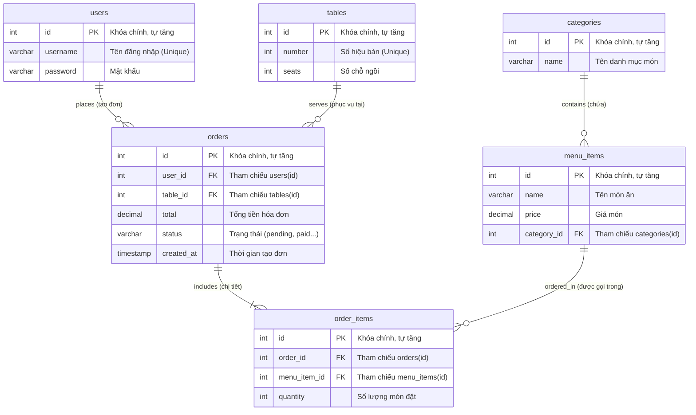
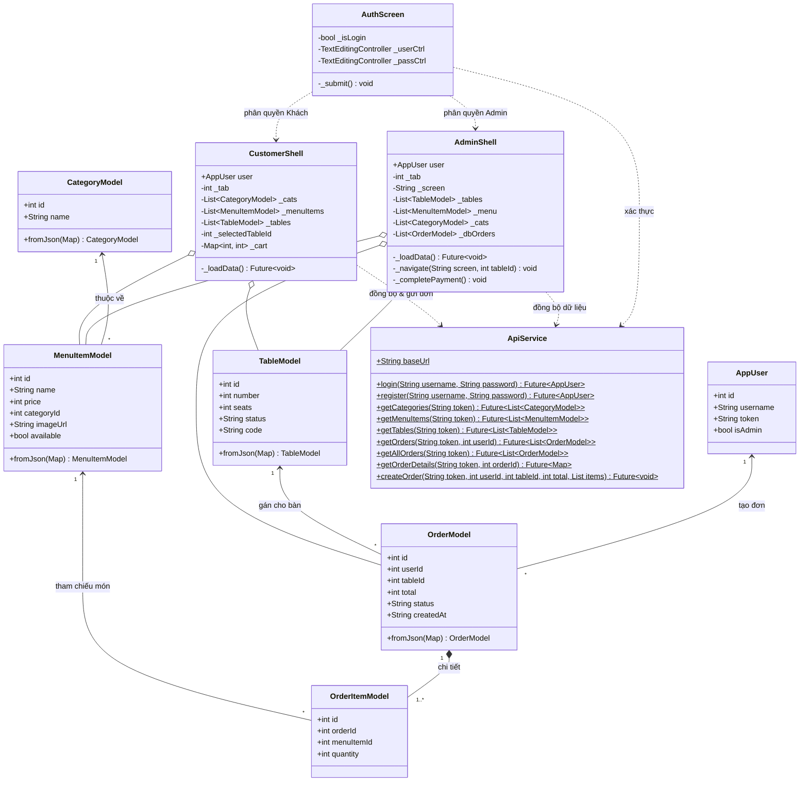

# TÀI LIỆU THIẾT KẾ KIẾN TRÚC VÀ DỮ LIỆU DỰ ÁN (PROJECT ARCHITECTURE & DATA DESIGN)
**Dự án:** Ứng dụng Quản lý Nhà hàng & Gọi món (Restaurant Management App)  
**Công nghệ:** Flutter (Frontend) + Dart Shelf (Backend API) + MySQL (Database)

---

## 1. SƠ ĐỒ HOẠT ĐỘNG (ACTIVITY DIAGRAM)

Mô tả luồng nghiệp vụ tổng thể từ khi người dùng đăng nhập hệ thống, phân quyền Khách hàng đặt món, lưu vào Database và Quản lý/Admin xử lý đơn hàng, chế biến tại bếp và thanh toán.

```mermaid
flowchart TD
    Start([Bắt đầu]) --> Login[Đăng nhập / Đăng ký hệ thống]

    Login --> CheckRole{Phân quyền tài khoản?}

    %% LUỒNG KHÁCH HÀNG
    subgraph CUSTOMER_FLOW ["Luồng Khách hàng"]
        CheckRole -->|Khách hàng thường| ViewTables[Xem danh sách bàn ăn]
        ViewTables --> SelectTable[Chọn bàn ăn còn trống]
        SelectTable --> ViewMenu[Duyệt danh mục & thực đơn món ăn]
        ViewMenu --> AddToCart[Thêm món & số lượng vào Giỏ hàng]
        AddToCart --> ConfirmCart{Xác nhận đặt món?}
        ConfirmCart -->|Chưa/Đổi món| ViewMenu
        ConfirmCart -->|Đồng ý| SendOrder[Gửi yêu cầu đặt món lên Server]
    end

    %% TẦNG HỆ THỐNG / BACKEND & DATABASE
    subgraph SYSTEM_BACKEND ["Hệ thống / Backend & Database"]
        SendOrder --> SaveDB[(Lưu vào bảng 'orders' & 'order_items')]
        SaveDB --> UpdateTableStatus[Cập nhật trạng thái bàn: 'Đang phục vụ']
        UpdateTableStatus --> NotifyAdmin[Thông báo đơn mới tới Admin]
    end

    %% LUỒNG ADMIN / QUẢN LÝ
    subgraph ADMIN_FLOW ["Luồng Admin / Quản lý nhà hàng"]
        CheckRole -->|Tài khoản 'admin'| AdminDash[Truy cập Dashboard Quản lý]
        NotifyAdmin -.-> AdminDash
        
        AdminDash --> ChooseAction{Chọn nghiệp vụ}
        
        ChooseAction -->|Bếp| ViewKitchen[Màn hình Bếp: Nhận vé món và chế biến]
        ViewKitchen --> CookingDone[Cập nhật trạng thái món hoàn tất]

        ChooseAction -->|Bàn ăn & Hóa đơn| ViewInvoices[Xem danh sách Hóa đơn từ Database]
        CookingDone --> ViewInvoices

        ViewInvoices --> RequestPayment[Khách yêu cầu thanh toán]
        RequestPayment --> SelectMethod[Chọn hình thức: Tiền mặt / Chuyển khoản / QR]
        SelectMethod --> ConfirmPay{Xác nhận thanh toán?}
        
        ConfirmPay -->|Hủy| ViewInvoices
        ConfirmPay -->|Xác nhận| ProcessPayment[Ghi nhận doanh thu & Xuất biên lai]
        ProcessPayment --> ClearTable[Chuyển trạng thái bàn về 'Trống']
        ClearTable --> UpdateStats[Cập nhật Báo cáo Doanh thu ngày]
    end

    UpdateStats --> End([Kết thúc phiên làm việc])
```

---

## 2. SƠ ĐỒ THỰC THỂ QUAN HỆ (ENTITY-RELATIONSHIP DIAGRAM - ERD)

Mô hình hóa cơ sở dữ liệu MySQL chuẩn 6 bảng hiện hành của dự án (`QLNH`).

---

## 3. SƠ ĐỒ LỚP (CLASS DIAGRAM)

Mô hình hóa cấu trúc hướng đối tượng trong Flutter bao gồm Model, Service và UI Shells.

